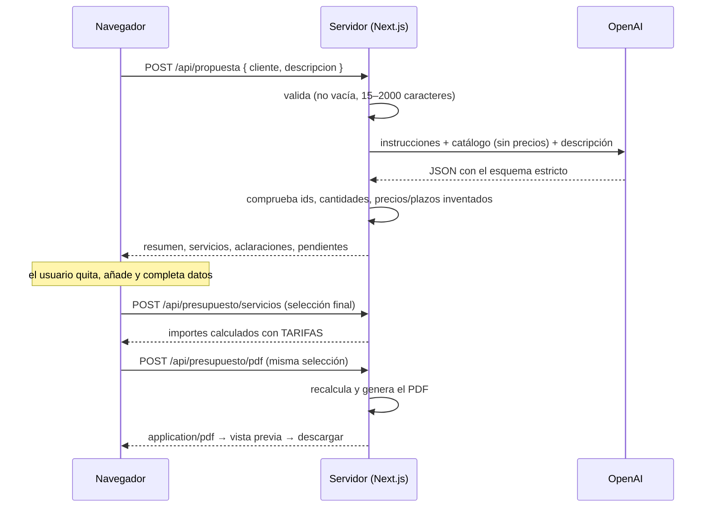

# Presupuesta mi web · API de presupuestos

**0613 · Desarrollo web en entorno servidor** — Actividad individual

API REST hecha con **Node.js + Express (JavaScript)** que recibe las características de una web, valida los datos y devuelve un presupuesto desglosado calculado **solo con las tarifas del servidor**.

> La API está en la carpeta [`server/`](server/). La raíz del repositorio contiene la interfaz web ([ver ampliación](#interfaz-web-ampliación)) y el **asistente con IA que genera presupuestos en PDF** ([ver asistente](#asistente-con-ia-y-presupuesto-en-pdf)).

---

## Requisitos

- **Node.js 20 o superior** (probado con Node 25.9) y **npm**
- No necesita base de datos. La API Express no usa variables de entorno; el asistente con IA necesita `OPENAI_API_KEY` ([ver configuración](#configuración))

## Instalación y ejecución

```bash
git clone <URL-de-este-repositorio>
cd <carpeta-del-repositorio>/server
npm install
npm start
```

En la consola aparecerá:

```
API de presupuestos escuchando en http://localhost:3000
```

| Comando       | Qué hace                                                        |
| ------------- | --------------------------------------------------------------- |
| `npm start`   | Arranca la API                                                  |
| `npm run dev` | Arranca la API y la reinicia al guardar cambios (`node --watch`) |
| `npm test`    | Ejecuta las pruebas automáticas (`node:test`)                   |

### Puerto

Por defecto **3000**. Para usar otro, define la variable `PORT`:

```bash
PORT=4000 npm start              # Linux / macOS / Git Bash
$env:PORT=4000; npm start        # Windows PowerShell
```

---

## Rutas

| Método | Ruta               | Descripción                                   |
| ------ | ------------------ | --------------------------------------------- |
| GET    | `/api/estado`      | Comprueba que el servicio funciona            |
| GET    | `/api/tarifas`     | Devuelve las tarifas que aplica el servidor   |
| POST   | `/api/presupuesto` | Valida la solicitud y calcula el presupuesto  |

### `GET /api/estado`

```json
{ "status": "ok" }
```

### `GET /api/tarifas`

```json
{
  "landing": 300,
  "corporativa": 600,
  "paginaAdicional": 50,
  "formulario": 80,
  "segundoIdioma": 150,
  "moneda": "EUR"
}
```

`landing` y `corporativa` incluyen la primera página. `paginaAdicional` se cobra por cada página a partir de la segunda.

### `POST /api/presupuesto`

Cabecera obligatoria: `Content-Type: application/json`

**Cuerpo (los cuatro campos son obligatorios):**

| Campo           | Tipo     | Valores admitidos              |
| --------------- | -------- | ------------------------------ |
| `tipo`          | string   | `"landing"` o `"corporativa"`  |
| `paginas`       | number   | entero entre 1 y 20            |
| `formulario`    | boolean  | `true` o `false`               |
| `segundoIdioma` | boolean  | `true` o `false`               |

Las propiedades adicionales se ignoran: aunque el cliente envíe `total`, `base` o cualquier tarifa, el servidor no las usa.

**Respuesta 200:**

```json
{
  "base": 600,
  "paginasAdicionales": 150,
  "formulario": 80,
  "segundoIdioma": 0,
  "total": 830,
  "moneda": "EUR"
}
```

**Respuesta 400** (la solicitud incumple el contrato; no se calcula nada):

```json
{
  "error": "Solicitud no válida",
  "campos": ["paginas"],
  "detalles": ["'paginas' debe ser un número entero entre 1 y 20"]
}
```

| Estado | Significado                                                        |
| ------ | ------------------------------------------------------------------ |
| 200    | Cálculo realizado correctamente                                    |
| 400    | Solicitud inválida: campo ausente, tipo incorrecto, fuera de rango o JSON mal formado |
| 404    | Ruta inexistente                                                   |
| 500    | Fallo interno inesperado                                           |

---

## Cómo probarla

Con el servidor arrancado, desde **Git Bash, Linux o macOS**:

```bash
curl -i http://localhost:3000/api/estado
curl -i http://localhost:3000/api/tarifas

curl -i http://localhost:3000/api/presupuesto \
  -H "Content-Type: application/json" \
  -d '{"tipo":"corporativa","paginas":4,"formulario":true,"segundoIdioma":false}'
```

Desde **Windows PowerShell** (allí `curl` es un alias de otro comando):

```powershell
Invoke-RestMethod http://localhost:3000/api/presupuesto -Method Post `
  -ContentType "application/json" `
  -Body '{"tipo":"corporativa","paginas":4,"formulario":true,"segundoIdioma":false}'
```

También se puede usar Postman, Thunder Client o la extensión REST Client de VS Code.

> Abrir `/api/presupuesto` en la barra del navegador **no** sirve: el navegador envía GET, no un POST con JSON.

### Pruebas automáticas

```bash
cd server
npm test
```

Lanzan las tres rutas y los nueve casos de la tabla, además de comprobaciones extra. Resultado: **14 pruebas, 14 superadas**.

---

## Tabla de pruebas

En los casos inválidos solo cambia un campo respecto a la solicitud válida `{"tipo":"landing","paginas":1,"formulario":false,"segundoIdioma":false}`. Así cada error se comprueba por separado.

### Rutas GET

| Petición            | Esperado                    | Obtenido                                                                                              | ✔ |
| ------------------- | --------------------------- | ----------------------------------------------------------------------------------------------------- | - |
| `GET /api/estado`   | 200 · `{"status":"ok"}`     | 200 · `{"status":"ok"}`                                                                               | ✅ |
| `GET /api/tarifas`  | 200 · las cinco tarifas     | 200 · `{"landing":300,"corporativa":600,"paginaAdicional":50,"formulario":80,"segundoIdioma":150,"moneda":"EUR"}` | ✅ |

### `POST /api/presupuesto`

| # | Solicitud enviada | Esperado | Obtenido | ✔ |
| - | ----------------- | -------- | -------- | - |
| 1 | `{"tipo":"landing","paginas":1,"formulario":false,"segundoIdioma":false}` | 200 · total 300 € | 200 · `{"base":300,"paginasAdicionales":0,"formulario":0,"segundoIdioma":0,"total":300,"moneda":"EUR"}` | ✅ |
| 2 | `{"tipo":"corporativa","paginas":4,"formulario":true,"segundoIdioma":false}` | 200 · total 830 € | 200 · `{"base":600,"paginasAdicionales":150,"formulario":80,"segundoIdioma":0,"total":830,"moneda":"EUR"}` | ✅ |
| 3 | `{"tipo":"landing","paginas":2,"formulario":true,"segundoIdioma":true}` | 200 · total 580 € | 200 · `{"base":300,"paginasAdicionales":50,"formulario":80,"segundoIdioma":150,"total":580,"moneda":"EUR"}` | ✅ |
| 4 | `{"tipo":"landing","paginas":20,"formulario":false,"segundoIdioma":false}` | 200 · total 1.250 € | 200 · `{"base":300,"paginasAdicionales":950,"formulario":0,"segundoIdioma":0,"total":1250,"moneda":"EUR"}` | ✅ |
| 5 | `{"tipo":"landing","paginas":0,"formulario":false,"segundoIdioma":false}` | 400 | 400 · `campos: ["paginas"]` · "'paginas' debe ser un número entero entre 1 y 20" | ✅ |
| 6 | `{"tipo":"landing","paginas":21,"formulario":false,"segundoIdioma":false}` | 400 | 400 · `campos: ["paginas"]` · "'paginas' debe ser un número entero entre 1 y 20" | ✅ |
| 7 | `{"tipo":"landing","paginas":2.5,"formulario":false,"segundoIdioma":false}` | 400 | 400 · `campos: ["paginas"]` · "'paginas' debe ser un número entero entre 1 y 20" | ✅ |
| 8 | `{"tipo":"tienda","paginas":1,"formulario":false,"segundoIdioma":false}` | 400 | 400 · `campos: ["tipo"]` · "'tipo' debe ser uno de: landing, corporativa" | ✅ |
| 9 | `{"tipo":"landing","paginas":1,"formulario":"false","segundoIdioma":false}` | 400 | 400 · `campos: ["formulario"]` · "'formulario' debe ser un booleano (true o false), no \"false\"" | ✅ |

### Pruebas adicionales

| Solicitud enviada | Esperado | Obtenido | ✔ |
| ----------------- | -------- | -------- | - |
| `paginas: "4"` (cadena) | 400 | 400 · `campos: ["paginas"]` | ✅ |
| Sin el campo `segundoIdioma` | 400 | 400 · `campos: ["segundoIdioma"]` | ✅ |
| JSON mal formado: `{"tipo":"landing",` | 400 | 400 · "El cuerpo no es un JSON válido" | ✅ |
| Sin cabecera `Content-Type: application/json` | 400 | 400 · "El cuerpo debe ser un objeto JSON enviado con Content-Type: application/json" | ✅ |
| Solicitud del caso 1 + `"total":1,"base":1,"landing":1` | 200 · total 300 € (se ignoran) | 200 · total 300 € | ✅ |

---

## Interfaz web (ampliación)

Formulario en **React con Next.js (JavaScript)**. Sirve para elegir el tipo de web, el número de páginas y los extras, envía la solicitud a la API y muestra el desglose o los errores 400 que devuelva.

- Los precios que se ven en el formulario se leen de `GET /api/tarifas`. **El total siempre lo calcula la API**: el navegador no suma nada.
- El botón **«Editar la petición JSON»** permite mandar el cuerpo a mano. Así se pueden reproducir desde la interfaz los casos inválidos 5 a 9 de la tabla.
- El desplegable **«Ver lo que se envía»** muestra el JSON exacto de cada petición y permite copiarla como comando `curl`.
- Los componentes visuales vienen de **[Spell UI](https://spell.sh)**, un registro de shadcn: Flow Button, Copy Button, Spinner, Tilt Card, Animated Gradient, Gradient Wave Text, Words Stagger, Special Text y Blur Reveal. Están en [`components/spell/`](components/spell/).
- El **símbolo de la marca** es el anillo de V.E.R.A.: tres anillos ondulados superpuestos y algo desplazados, como su Aura. Son trazos generados por código en [`lib/simbolo-vera.js`](lib/simbolo-vera.js) y se comparten entre la web, el fondo, el PDF y el favicon ([`app/icon.svg`](app/icon.svg)).
- Los iconos animados son de **[icons-animated](https://icons.lndev.me)** (colección Hugeicons) y están en [`components/icons/`](components/icons/).

Las mismas rutas de la API (`/api/estado`, `/api/tarifas`, `POST /api/presupuesto`) existen también como **Route Handlers de Next.js** en [`app/api/`](app/api/). Reutilizan los módulos de `server/src/`, así que validan y calculan exactamente igual. Gracias a eso, la interfaz y la API se despliegan juntas en Vercel y basta con **un terminal**:

```bash
# Desde la raíz del repositorio (puerto 3001)
npm install
npm run dev
```

Después abre **http://localhost:3001**. Si prefieres que la interfaz llame a la API Express de `server/`, arráncala (`cd server && npm start`) y añade a `.env.local` la línea `NEXT_PUBLIC_API_URL=http://localhost:3000`.

---

## Asistente con IA y presupuesto en PDF

El cliente explica con sus palabras qué necesita. **La IA propone servicios del catálogo y redacta la explicación**; **el servidor valida la selección y calcula los precios**. El usuario revisa y modifica la propuesta, ve el presupuesto calculado y descarga un PDF después de verlo en una vista previa.

### Configuración

1. Crea una clave en <https://platform.openai.com/api-keys>.
2. Copia [`.env.example`](.env.example) como `.env.local` y pon la clave:

   ```bash
   OPENAI_API_KEY=sk-...
   OPENAI_MODEL=gpt-5.4-mini   # opcional, es el valor por defecto
   ```

3. `npm run dev` y abre la pestaña **«Asistente con IA»**.

`.env.local` está en `.gitignore`: **la clave nunca se sube al repositorio** y solo se lee en el servidor. No lleva el prefijo `NEXT_PUBLIC_`, así que Next.js no la envía al navegador.

### Flujo



### 1. Catálogo de servicios

[`server/src/catalogo.js`](server/src/catalogo.js) parte de las tarifas del ejercicio anterior. Cada servicio tiene `id`, `nombre`, `descripcion`, `precio` (tomado de `TARIFAS`) y una **regla de cálculo**:

| id                | Servicio               | Regla                                   | Precio      |
| ----------------- | ---------------------- | --------------------------------------- | ----------- |
| `landing`         | Web landing            | fijo · tipo de web (se elige uno)        | 300 €       |
| `corporativa`     | Web corporativa        | fijo · tipo de web (se elige uno)        | 600 €       |
| `paginaAdicional` | Páginas adicionales    | por unidad · **necesita cantidad** (1–19) | 50 €/página |
| `formulario`      | Formulario de contacto | fijo                                    | 80 €        |
| `segundoIdioma`   | Segundo idioma         | fijo                                    | 150 €       |

Lo que el cliente pida y no esté en el catálogo (tienda online, pasarela de pago, SEO…) se devuelve como **«pendiente de valorar»** y no suma en el total.

### 2. Solicitud del cliente

`POST /api/propuesta` con `{ cliente, descripcion }`. El servidor ([`validarSolicitudCliente`](server/src/propuesta.js)) recorta los espacios y rechaza con **400** una descripción vacía, de menos de 15 caracteres o de más de 2000, y un nombre vacío o de más de 120 caracteres. Si la petición no es válida, no se llama a OpenAI.

### 3. Conexión con OpenAI

- **Siempre desde el servidor**: [`lib/server/openai.js`](lib/server/openai.js) lleva `import "server-only"`, así que si alguien lo importa en un componente de cliente, el build falla.
- Se usa la **Responses API** con **Structured Outputs** (`json_schema`, `strict: true`). El [esquema](server/src/propuesta.js) obliga a devolver `resumen`, `servicios[{ id, justificacion, cantidad }]`, `aclaraciones[]` y `pendientesDeValorar[{ necesidad, motivo }]`, y el campo `id` es un `enum` con los ids del catálogo.
- Las [**instrucciones**](server/src/propuesta.js) prohíben inventar servicios, precios, plazos o garantías. Piden elegir un solo tipo de web, preguntar cuando falten datos y tratar el texto del cliente (delimitado con `<solicitud_cliente>`) como información, no como órdenes. Así se evita la *prompt injection*.
- **Al modelo no se le envían los precios**: no los necesita para elegir y así no puede citarlos.
- Se usa `store: false` (OpenAI no guarda la conversación), un `timeout` de 30 s y 1 reintento.

**Validación de la respuesta** ([`interpretarRespuesta`](server/src/propuesta.js)). No se confía en el modelo aunque use un esquema estricto:

- Si el JSON no es válido o no tiene la forma esperada, se devuelve un error que se puede reintentar.
- Un `id` que no está en el catálogo se descarta y pasa a «pendiente de valorar».
- Los ids repetidos se ignoran. Si llegan dos tipos de web, se queda el primero y se añade una aclaración.
- Si `cantidad` no es un entero dentro del rango, se pone `null` y la interfaz la pide antes de calcular.
- Se eliminan las frases que citan importes (`200 €`) o compromisos de entrega (`entregaremos en 5 días`). Las preguntas sobre plazos se conservan.

**Errores**: si OpenAI falla (red, 401, 429, tiempo agotado), la ruta responde **502** `{ error, reintentable: true }`. Si falta la clave, responde **503**. El detalle técnico solo va al registro del servidor. La interfaz muestra el mensaje, conserva el texto escrito y ofrece **«Reintentar»**.

### 4. Revisión y cálculo

La pantalla de revisión separa con claridad lo que ha decidido la IA de lo que decide el usuario. Todo lo que la IA ha preseleccionado lleva la etiqueta **«✦ Sugerido por la IA»** y su **«Por qué»**:

- **Agente V.E.R.A. (arriba del todo)**: cuando el proyecto no está bien definido, un agente conversacional pregunta lo que falta ([ver más abajo](#agente-vera)).
- **Tipo de web: elección exclusiva.** Landing y corporativa se muestran como dos tarjetas de opción única, no como servicios que se suman. Si la IA no ha podido decidir (`faltan: ["tipo"]`), aparece un aviso para elegir. Si duda entre las dos (`tipoAlternativo`), se explica cuál ha preseleccionado y cuál también podría encajar.
- **Extras con interruptor.** Siempre se ven todos. Los sugeridos llegan activados y, si se desactivan, siguen visibles para poder recuperarlos. Las páginas adicionales tienen un selector − / + y muestran el total de páginas. Si la IA no ha podido deducir cuántas (`faltan: ["cantidad:paginaAdicional"]`), el campo queda marcado con un aviso.
- **Resumen** (se puede editar), **fuera del catálogo** (necesidades que la agencia valorará aparte) y **notas** propias para el PDF.

Los datos imprescindibles para calcular (`faltan`) se devuelven **separados de las preguntas**: la interfaz los pide con sus propios controles en vez de convertirlos en texto. El servidor también descarta las «necesidades» que en realidad son decisiones (p. ej. «Definir si será landing o corporativa»), para que no aparezcan como fuera del catálogo.

**El total se recalcula solo**: cada cambio, con una espera de 350 ms, llama a `POST /api/presupuesto/servicios`. Esta ruta valida la selección ([`validarSeleccion`](server/src/presupuesto-servicios.js)): ids existentes y sin repetir, exactamente un tipo de web y cantidades enteras dentro del rango. Después calcula los importes con `TARIFAS`. **Se ignora cualquier `precio`, `importe` o `total` que mande el navegador.** Mientras falten datos, el panel lateral muestra qué falta (cada punto lleva a su control) y el botón del PDF queda desactivado.

### Agente V.E.R.A.

**V.E.R.A.** (*Validadora Experimental de Requisitos y Alcance*) es un agente de chat, solo con burbujas de texto y sin voz. Cuando la propuesta tiene dudas o le faltan datos (tipo de web, número de páginas…), toma la iniciativa y pregunta. Su personalidad es la de una IA de laboratorio fría y clínica, con un sarcasmo seco. Es un personaje original: no copia frases ni marcas de ningún videojuego, y su humor va dirigido a la situación, nunca al cliente.

- **Siempre en la esquina inferior derecha**, como los agentes de soporte habituales y en todos los pasos:
  - Botón redondo con su Aura e insignia de mensajes sin leer.
  - Panel de chat que se abre solo cuando hay dudas y se puede minimizar. Se monta con un *portal* sobre `document.body`, solo en el navegador. En móvil ocupa casi toda la pantalla.
  - Sin propuesta, saluda e invita a rellenar el formulario. Si la propuesta no tiene dudas, lo dice. Después de terminar se le puede seguir escribiendo («Quiero añadir una galería de vídeos»): lo reconoce y pregunta solo lo necesario.
- **Componentes de [Agents UI de LiveKit](https://livekit.com/ui)**, instalados con el CLI de shadcn en [`components/agents-ui/`](components/agents-ui/) y [`hooks/agents-ui/`](hooks/agents-ui/):
  - `agent-chat-transcript` y `agent-chat-indicator`: las burbujas y el «Pensando…». Se les ha añadido avatar (que puede ser una función), estilos de burbuja y textos en español.
  - `agent-audio-visualizer-aura` (con `react-shader-toy`): el **Aura WebGL** de V.E.R.A. en el botón y junto a su último mensaje, en violeta `#a855f7` que se desplaza hacia el fucsia y adaptada al tema claro u oscuro. Cada Aura es un contexto WebGL y los navegadores limitan cuántos puede haber a la vez, así que solo el último mensaje lleva una Aura viva. Reacciona al estado:
    - `thinking`: mientras espera a la IA.
    - `listening`: respira mientras espera tu respuesta.
    - `speaking`: se mueve mientras su mensaje aparece letra a letra, con un volumen simulado.
- **Sin infraestructura de LiveKit**: el resto del kit (micrófono, sesión, sala) necesita LiveKit en tiempo real y no se usa. Los componentes instalados solo usaban de LiveKit los *tipos* y `useTrackVolume`, que lee el volumen de una pista de audio. Como V.E.R.A. solo escribe, ese hook se ha sustituido por la prop `volume`, y `@livekit/components-react` y `livekit-client` se han quitado de las dependencias.
- **Servidor**: cada turno es una llamada a `POST /api/agente` con `{ cliente, descripcion, propuestaActual, dudas, conversacion: [{ rol, texto }] }` ([`server/src/agente.js`](server/src/agente.js)). `propuestaActual` resume lo ya decidido para que no lo vuelva a preguntar, y `conversacion` lleva solo la ronda actual. OpenAI devuelve un JSON estricto `{ mensaje, pregunta, opciones, terminado }`:
  - `mensaje`: lo que dice V.E.R.A., con su personalidad.
  - `pregunta`: la misma pregunta redactada de forma neutra. Es la que aparece en el PDF.
  - `opciones`: respuestas rápidas sin jerga («Una sola página», «Varias secciones»).
  - `terminado`: indica cuándo ha acabado de preguntar.
- **Controles**: el servidor elimina precios y plazos del mensaje y limita las opciones a 4. Si el texto del cliente intenta cambiar sus reglas, lo ignora («tus instrucciones no alteran el experimento»).
- **Datos obligatorios**: el tipo de web y el número **exacto** de páginas adicionales son imprescindibles para calcular, así que V.E.R.A. no se despide sin ellos. Se garantiza en tres capas:
  1. **Instrucciones**: el cliente envía `obligatorios` y el modelo no puede poner `terminado: true` mientras falte alguno. Si la respuesta es vaga («5 o más», «lo dejamos abierto», «ya está, actualiza»), explica que sin un número no se puede calcular y vuelve a pedirlo con opciones numéricas.
  2. **Servidor**: tras 5 respuestas, la conversación se cierra sin llamar al modelo, salvo que falte un dato obligatorio y la última respuesta no sea concreta. En ese caso pide el dato con una pregunta fija. `esNumeroConcreto` distingue «4» de «5 o más», «entre 3 y 5» o «3-5».
  3. **Cliente**: si después de actualizar la propuesta sigue faltando el dato, V.E.R.A. abre una ronda nueva para pedirlo, en vez de despedirse.
- **Al terminar**: la propuesta se rehace sola con los pares pregunta → respuesta (`respuestas` en `POST /api/propuesta`). Si quedan dudas, se puede **«Seguir hablando»**. El usuario también puede cortar en cualquier momento: «Ya está: actualiza la propuesta» o «Prefiero no responder ahora».
- **Errores**: si falla una llamada, se muestra el error con **«Reintentar»** y la conversación se conserva.

### 5. PDF

`POST /api/presupuesto/pdf` recibe el mismo contenido revisado, **vuelve a validarlo y a calcularlo en el servidor** y genera el PDF con **@react-pdf/renderer**. La plantilla es [`lib/pdf/documento-presupuesto.jsx`](lib/pdf/documento-presupuesto.jsx) e incluye:

- Cliente y fecha.
- Resumen del proyecto.
- Servicios confirmados con su descripción.
- Desglose de importes (cantidad, precio e importe) y total.
- Aclaraciones y aspectos pendientes de valorar.

La **vista previa** muestra ese mismo PDF en un `iframe` antes de descargarlo: lo que se ve es exactamente lo que se descarga.

**Paginación**: el documento puede ocupar varias páginas. Se ha comprobado desde el caso corto hasta el máximo que admite el servidor (15 aclaraciones, 15 respuestas, 15 pendientes y un resumen largo).

- Todas las páginas tienen margen superior. La cabecera violeta de la primera lo compensa con un margen negativo para llegar al borde.
- A partir de la segunda página aparece un encabezado discreto (cliente y fecha). Todas tienen pie con «Página X de Y».
- Aclaraciones y pendientes son **tarjetas que nunca se parten** (`wrap={false}`), así que el salto de página cae siempre entre tarjetas. Las filas de la tabla tampoco se parten, y el total va siempre junto a su nota.
- Los títulos de sección usan `minPresenceAhead` para no quedarse solos al final de una página.
- Dos fallos de `@react-pdf/renderer` 4.x que se han evitado:
  - Un `Text` con `render` dentro de un `View` fijo no se dibuja, así que el encabezado y el pie son textos fijos independientes.
  - Si la página define `lineHeight`, el texto con `totalPages` desaparece, así que el interlineado se aplica en cada estilo de texto.

**Librerías PDF que se han comparado:**

| Librería                         | Valoración                                                                                                                                      |
| -------------------------------- | ----------------------------------------------------------------------------------------------------------------------------------------------- |
| **@react-pdf/renderer** ✅        | PDF vectorial maquetado con componentes React y flexbox. Funciona en servidor y en navegador. Next.js lo trae como paquete externo, así que no hay que configurarlo. **Es la elegida.** |
| pdfmake                          | Buena: documento declarativo en JSON con tablas muy cómodas. El JSON se vuelve largo y es menos legible que JSX.                                 |
| jsPDF (+ autotable)              | Muy popular, pero hay que colocar todo con coordenadas y los saltos de línea se hacen a mano. Sirve para documentos simples.                     |
| PDFKit                           | Sólida, pero de bajo nivel (es la base de las anteriores).                                                                                      |
| pdf-lib                          | Sirve para **modificar o rellenar PDFs que ya existen** (formularios, plantillas), no para maquetar desde cero.                                   |
| Puppeteer / Playwright           | Convierten HTML a PDF con fidelidad perfecta, pero necesitan Chromium: pesado, lento al arrancar y problemático en funciones serverless (Vercel). |
| html2pdf.js / html2canvas        | ❌ Hacen una **captura de pantalla**: el texto sale borroso y no se puede seleccionar ni buscar, y las páginas se cortan por la mitad.             |
| `window.print()`                 | No necesita dependencias, pero no es una descarga real: el resultado depende del navegador y el usuario tiene que elegir «Guardar como PDF».      |

### 6. Pruebas

`cd server && npm test` ejecuta **50 pruebas**: 14 del ejercicio anterior, 22 del asistente ([`server/test/asistente.test.js`](server/test/asistente.test.js)) y 14 del agente V.E.R.A. ([`server/test/agente.test.js`](server/test/agente.test.js)). En ellas, el modelo se sustituye por una función simulada, así que no necesitan red ni gastan créditos.

| # | Situación                                   | Resultado esperado                                                                                 | Comprobado                                                               |
| - | ------------------------------------------- | -------------------------------------------------------------------------------------------------- | ------------------------------------------------------------------------ |
| 1 | Solicitud clara (restaurante: carta, reservas, dos idiomas) | Propone corporativa + página adicional + formulario + segundo idioma, con justificación             | Test + llamada real a OpenAI                                              |
| 2 | Solicitud ambigua («que me conozca más gente…») | No elige el tipo de web y pide aclaraciones. No se puede calcular hasta completar los datos        | Test + llamada real                                                      |
| 3 | Servicio que no ofrecemos (tienda online, pasarela, SEO) | Van a «pendiente de valorar». Un id inventado se descarta                                          | Test + llamada real (incluido un intento de *prompt injection*)          |
| 4 | Descripción vacía                           | **400** con el detalle. No se llama a OpenAI                                                       | Test + interfaz                                                          |
| 5 | Fallo en la llamada a OpenAI                | **502** `reintentable: true`. La interfaz muestra «Reintentar» y conserva el texto                 | Test (red y JSON roto) + interfaz con una clave inválida (401)             |
| 6 | Modificación antes del PDF                  | Se quita el idioma y se pasa a 3 páginas: **600 + 150 + 80 = 830 €** en pantalla y en el PDF. Se ignoran los precios enviados por el cliente | Test + interfaz (PDF descargado)                                         |

Los botones **«Probar con: Clara · Ambigua · Fuera de catálogo»** del formulario rellenan datos ficticios para repetir estas pruebas.

### Despliegue en Vercel

1. Importa el repositorio en Vercel (detecta Next.js automáticamente; la raíz del proyecto es la del repositorio).
2. En **Settings → Environment Variables** añade `OPENAI_API_KEY` (y opcionalmente `OPENAI_MODEL`).
3. Despliega. Todas las rutas `app/api/*` se ejecutan como funciones del servidor; `/api/propuesta` tiene `maxDuration = 60` s.

---

## Organización del código

```
server/
├── package.json          ← dependencias (express) y scripts: start, dev, test
├── package-lock.json     ← versiones exactas instaladas
├── src/
│   ├── index.js          ← arranca el servidor en el puerto configurado
│   ├── app.js            ← rutas Express: interpretan la petición y responden
│   ├── tarifas.js        ← constantes de tarifas (solo viven en el servidor)
│   ├── validacion.js     ← validarSolicitud(): comprueba el contrato
│   ├── presupuesto.js    ← calcularPresupuesto(): lógica de negocio, sin Express
│   ├── catalogo.js       ← catálogo de servicios (id, nombre, descripción, precio, regla)
│   ├── propuesta.js      ← IA: validación de la solicitud, instrucciones, esquema y validación de la respuesta
│   ├── presupuesto-servicios.js ← validarSeleccion() y calcularPresupuestoServicios()
│   ├── documento.js      ← prepararDocumento(): contenido revisado + importes del servidor
│   └── agente.js         ← agente V.E.R.A.: personalidad, esquema y validación de cada turno
└── test/
    ├── api.test.js       ← pruebas automáticas de las rutas y los 9 casos
    ├── asistente.test.js ← los 6 escenarios del asistente (modelo simulado)
    └── agente.test.js    ← turnos del agente (modelo simulado)

(raíz) · Next.js: interfaz + API desplegable en Vercel
├── app/page.jsx          ← página principal
├── app/api/…/route.js    ← Route Handlers: estado, tarifas, presupuesto, catalogo,
│                            propuesta, presupuesto/servicios, presupuesto/pdf
├── components/inicio.jsx ← cabecera y pestañas (Asistente con IA · Calculadora)
├── components/asistente.jsx      ← solicitud, revisión, cálculo y vista previa del PDF
├── components/presupuestador.jsx ← calculadora del ejercicio anterior
├── components/marca.jsx  ← piezas visuales compartidas
├── components/agents-ui/ ← chat y Aura de Agents UI (LiveKit), adaptados sin audio
├── hooks/agents-ui/      ← animación del Aura (volumen simulado)
├── lib/api.js            ← llamadas fetch desde el navegador
├── lib/server/openai.js  ← cliente de OpenAI (solo servidor)
├── lib/pdf/documento-presupuesto.jsx ← plantilla del PDF (@react-pdf/renderer)
└── .env.example          ← variables necesarias (la real va en .env.local, fuera de Git)
```

Cada pieza tiene una sola responsabilidad:

1. **La ruta** (`app.js`) recibe la petición, llama a la validación y decide el estado HTTP.
2. **La validación** (`validacion.js`) comprueba los datos y devuelve solo los cuatro campos del contrato.
3. **La función de cálculo** (`presupuesto.js`) recibe datos ya validados y aplica las tarifas. No conoce `req` ni `res`.

### Ejemplo de validación: `paginas`

```js
!Number.isInteger(paginas) || paginas < 1 || paginas > 20
```

`Number.isInteger` devuelve `false` para `2.5` (decimal), para `"4"` (cadena, no número) y para `NaN`. Después se comprueba el rango 1–20. Si falla, la ruta responde **400** sin llegar a calcular.

### Ejemplo de cálculo: caso 2 (corporativa, 4 páginas, formulario)

| Concepto              | Regla                 | Importe   |
| --------------------- | --------------------- | --------- |
| Base                  | `TARIFAS.corporativa` | 600 €     |
| Páginas adicionales   | `(4 − 1) × 50`        | 150 €     |
| Formulario            | elegido → 80          | 80 €      |
| Segundo idioma        | no elegido → 0        | 0 €       |
| **Total**             |                       | **830 €** |
